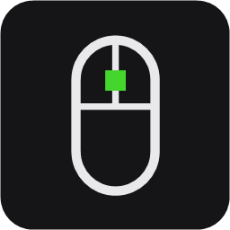

<div align="center">



# Razer Native

**Everything Synapse does for your Razer mouse, in a 17 MB app that stays out of your way.**

[](https://github.com/Visxoz/open-synapse/actions/workflows/ci.yml)
[](#download)
[](#building-from-source)
[](LICENSE)
[](#supported-mice)

</div>

---

Razer Native is a small, fast control panel for Razer mice on Windows. Set your DPI, polling rate, lighting, battery options and profiles without installing Razer Synapse.

No account. No sign-in. No background services or updaters. One file you can run, and delete, whenever you like.

## Why people switch

- **Light.** About 35 MB of memory and a near-zero share of your processor while it sits in the tray. Synapse and its helper services take several times that.
- **Instant.** Opens in a blink. Settings apply the moment you change them.
- **Yours.** Settings live in a plain file on your PC, not in the cloud. Nothing phones home.
- **Honest.** Free and open source. You can read every line of what runs on your machine.

## What it does

### Performance
- Up to five DPI stages, with separate horizontal and vertical values if you want them.
- A DPI ruler you can drag, or type an exact number.
- Polling rate, up to 8000 Hz on HyperPolling mice.
- Scroll wheel modes on mice that have them: free spin, acceleration and Smart Reel.
- Windows' own pointer settings in the same place: pointer speed, "enhance pointer precision", scroll lines and double-click speed.

### Lighting
- Static, breathing, spectrum, wave, reactive, blinking and more, chosen per zone.
- A colour picker with presets, plus brightness.
- A live preview on a drawing of your actual mouse.

### Power
- Battery level and charging state, in the window and in the tray.
- Sleep timer and low-power threshold.
- What the lights on your HyperPolling receiver show.

### Profiles
- Keep different setups for work, play or particular games.
- Link a profile to a program and it switches on by itself when that program is in front, and back when it is not.
- Switch profiles from the tray without opening the window.

### Everyday details
- Lives in the notification area and can start with Windows.
- Mice appear as you plug them in. A wireless mouse that is asleep is shown as asleep until you nudge it.
- Each mouse is drawn from Razer's own picture of it, traced into line art that matches the app.

## Download

1. Grab the latest `.zip` from the [Releases](https://github.com/Visxoz/open-synapse/releases) page.
2. Unzip it anywhere and run `razer-native.exe`. There is no installer.
3. **Close Razer Synapse first** if you have it. Synapse keeps re-applying its own settings to the mouse.

Windows may show a SmartScreen warning the first time, because the app is not code-signed. Choose **More info** and then **Run anyway**.

To remove it, delete the executable. Your settings are in `%APPDATA%\razer-native` if you want those gone too.

## Supported mice

116 models, from the 2012 Naga to the Viper V4 Pro, across these families:

| Family | Models | Family | Models |
| --- | ---: | --- | ---: |
| DeathAdder | 24 | Abyssus | 6 |
| Naga | 18 | Lancehead | 5 |
| Basilisk | 17 | Cobra | 5 |
| Viper | 16 | Orochi | 4 |
| Mamba | 8 | Atheris, Diamondback, Imperator, Ouroboros, Taipan | 1 each |
| Pro Click | 7 | HyperPolling Wireless Dongle | 1 |

Device data comes from the [OpenRazer](https://openrazer.github.io) project. If your mouse works with OpenRazer on Linux, it almost certainly works here.

## Tips

- **Your own picture.** Put a top-down PNG of your mouse, named after its product ID (for example `00e6.png`), in `%APPDATA%\razer-native\images`. The app traces it into line art on the next start. The product ID is shown on the Device page.
- **Starting hidden.** Turn on *Start with Windows* in Settings and the app opens quietly in the tray at sign-in.
- **Two copies.** Launching the app while it is already running just brings the existing window to the front.

## Not included

Button remapping and macros, firmware updates, Chroma game integrations, and anything that is not a mouse: keyboards, headsets, mouse mats and so on.

## Building from source

You need Rust 1.88 or newer with the MSVC toolchain.

```powershell
cargo build --release
```

The executable is `target\release\razer-native.exe`.

## Credits

- [OpenRazer](https://openrazer.github.io) for the device protocol and the table of supported mice.
- [Slint](https://slint.dev) for the UI toolkit.

## Licence

GPL-3.0-only. The device table is derived from OpenRazer, which is GPL-2.0-or-later.

Razer Native is an independent project and is not affiliated with or endorsed by Razer Inc. Razer, Synapse and the product names above are trademarks of Razer Inc.
