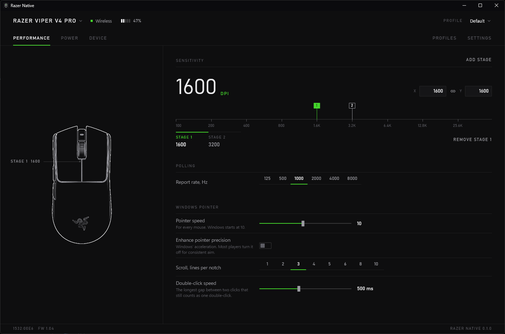
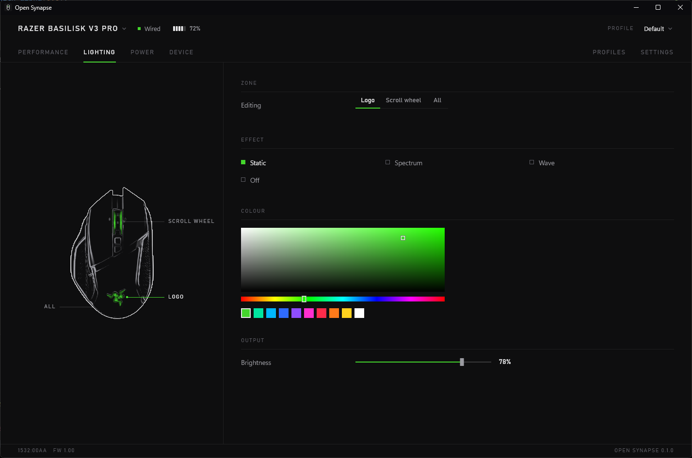
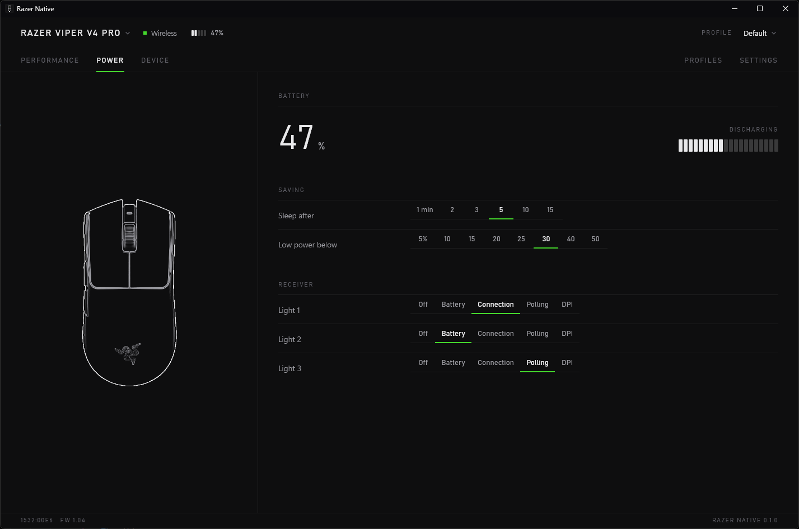
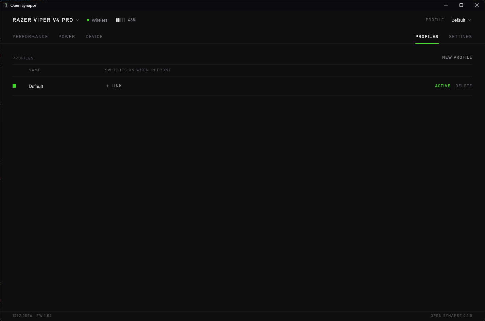
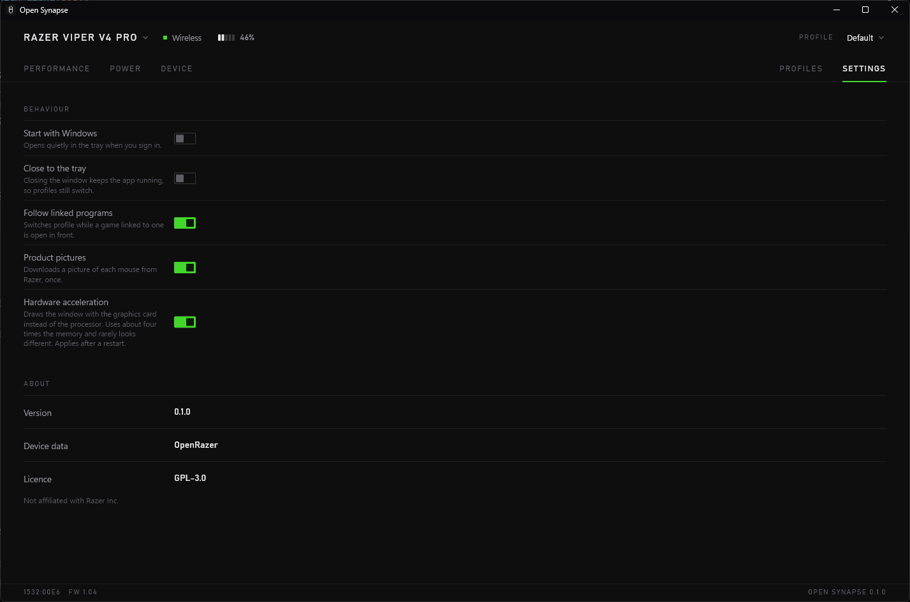

<div align="center">


# Open Synapse

**Your Razer mouse, without Razer Synapse.**

DPI, polling rate, lighting, battery and profiles in one small app for Windows, Linux and macOS.<br>
No account, no sign-in, no services running in the background.

[](https://github.com/Visxoz/open-synapse/actions/workflows/ci.yml)
[](#download)
[](#linux)
[](#macos)
[](#supported-mice)
[](LICENSE)

<br>



</div>

<br>

Razer Synapse is a lot of software for what most people actually want from it: set a DPI, pick a colour, maybe swap profiles when a game opens. Open Synapse does those things and stops there. It is a single 17 MB executable that opens instantly, idles in the tray at around 35 MB of memory, and keeps your settings in a plain file on your own PC.

It speaks to the mouse directly, the same way Synapse does, so settings land on the hardware itself and stay there when the app is closed. Every model that works with OpenRazer works here too, from the 2012 Naga to the Viper V4 Pro, and on Linux it needs no kernel driver.

<br>

## A quick tour

<table>
<tr>
<td width="55%"></td>
<td width="45%" valign="top">
<h3>Lighting</h3>
<p>Pick a zone, pick an effect, pick a colour. Static, breathing, spectrum, wave, reactive and the rest, with brightness on a fader. The drawing on the left is your actual mouse, traced from Razer's own render, and it previews the effect as you choose it.</p>
</td>
</tr>
<tr>
<td width="45%" valign="top">
<h3>Power</h3>
<p>Battery level and charging state, in the window and in the tray icon. Set how long the mouse waits before it sleeps and where low-power mode kicks in. If you have a HyperPolling receiver, choose what its lights show.</p>
</td>
<td width="55%"></td>
</tr>
<tr>
<td width="55%"></td>
<td width="45%" valign="top">
<h3>Profiles</h3>
<p>Keep one setup for work and another for each game. Link a profile to a program and it takes over whenever that program is in front, then hands back when you alt-tab away. You can also switch by hand from the tray menu. On Linux this follows X11 windows, which includes games under Wine and Proton, as Wayland does not say which program is in front.</p>
</td>
</tr>
<tr>
<td width="45%" valign="top">
<h3>Out of the way</h3>
<p>Start at sign-in, close to the tray, and forget it is there. Mice show up as you plug them in. A wireless mouse that has gone to sleep is shown asleep until you nudge it, rather than as missing.</p>
</td>
<td width="55%"></td>
</tr>
</table>

### And on the Performance page

Up to five DPI stages on a ruler you can drag, with separate horizontal and vertical values if you want them. Polling rate up to 8000 Hz on HyperPolling mice. Scroll wheel modes on mice that have them. On Windows, the system's own pointer settings sit on the same page, so pointer speed, acceleration, scroll lines and double-click speed are one click away instead of buried in Control Panel.

<br>

## Download

Grab the latest build from the [Releases](https://github.com/Visxoz/open-synapse/releases) page.

> [!IMPORTANT]
> Close Razer Synapse before you start, if you have it. Synapse keeps pushing its own settings to the mouse and the two will fight.

### Windows

| File | What it does |
| --- | --- |
| `open-synapse_x.y.z_x64-setup.exe` | Installs for your account with a Start menu entry. No admin rights needed. |
| `open-synapse_x.y.z_x64-portable.exe` | Runs from wherever you put it. Nothing is installed. |

Windows may show a SmartScreen warning the first time because the app is not code-signed. Click **More info**, then **Run anyway**.

### Linux

> [!NOTE]
> Linux and macOS support is new and has not yet been tried with a mouse attached. If you try it, please [open an issue](https://github.com/Visxoz/open-synapse/issues) to say how it went, whether it worked or not.

Unpack `open-synapse_x.y.z_linux-x86_64.tar.gz` and run `./install.sh`. It puts the app in `~/.local/bin` with a menu entry, and, with `sudo`, adds a udev rule so you can open the mouse without being root:

```sh
SUBSYSTEM=="hidraw", KERNELS=="*:1532:*", TAG+="uaccess"
```

Without the rule the app finds the mouse but is not allowed to open it, and says so. The tray icon needs a desktop that shows StatusNotifier icons, as KDE does, and GNOME does with the AppIndicator extension. Without one, launching the app again brings back a window closed to the tray.

### macOS

Unzip `open-synapse_x.y.z_macos-aarch64.zip` (Apple silicon) or `open-synapse_x.y.z_macos-x86_64.zip` (Intel) and move **Open Synapse** to Applications. It is not notarised yet, so the first time, macOS will refuse to open it; go to **System Settings ▸ Privacy & Security** and choose **Open Anyway**. If macOS asks to let it monitor input, allow it: that is how it reaches the mouse.

Every build checks GitHub for new versions and can update itself from Settings. Each download is checked against the release's SHA-256 sums before anything is written to disk.

<br>

## Supported mice

116 models across every family Razer has made since 2012.

<details>
<summary>Show the breakdown</summary>
<br>

| Family | Models | | Family | Models |
| --- | ---: | --- | --- | ---: |
| DeathAdder | 24 | | Abyssus | 6 |
| Naga | 18 | | Lancehead | 5 |
| Basilisk | 17 | | Cobra | 5 |
| Viper | 16 | | Orochi | 4 |
| Mamba | 8 | | Atheris, Diamondback, Imperator, Ouroboros, Taipan | 1 each |
| Pro Click | 7 | | HyperPolling Wireless Dongle | 1 |

</details>

The device data comes from [OpenRazer](https://openrazer.github.io). If your mouse works there, it works here.

<br>

## Questions you might have

<details>
<summary><b>Does it do button remapping or macros?</b></summary>
<br>
Not yet. The same goes for firmware updates, Chroma game integrations, and anything that is not a mouse. Keyboards, headsets and mats are out of scope.
</details>

<details>
<summary><b>Where do my settings live?</b></summary>
<br>
In <code>%APPDATA%\open-synapse</code> on Windows, <code>~/.config/open-synapse</code> on Linux and <code>~/Library/Application Support/open-synapse</code> on macOS, as two JSON files you can open and read. Delete the folder and the app forgets everything.
</details>

<details>
<summary><b>How do I uninstall it?</b></summary>
<br>
On Windows, the installed version goes through <b>Settings ▸ Apps</b> like any other program; for the portable one, delete the executable. On Linux, delete <code>~/.local/bin/open-synapse</code>, its menu entry in <code>~/.local/share/applications</code> and, if you like, <code>/etc/udev/rules.d/70-open-synapse.rules</code>. On macOS, move the app to the Bin. None of this touches the mouse's own memory, so your DPI and lighting stay as you left them.
</details>

<details>
<summary><b>Can I use my own picture of the mouse?</b></summary>
<br>
Yes. Drop a top-down PNG into the <code>images</code> folder inside the settings folder above, named after the product ID shown on the Device page (for example <code>00e6.png</code>). The app traces it into line art on the next start.
</details>

<details>
<summary><b>I opened it twice and only one window appeared.</b></summary>
<br>
That is on purpose. Launching the app while it is already running brings the existing window to the front.
</details>

<br>

## Building it yourself

You need a Rust toolchain (1.89 or newer; on Windows the MSVC one). On Linux you also need a C compiler and the fontconfig, freetype and xkbcommon headers (`libfontconfig1-dev libfreetype-dev libxkbcommon-dev` on Debian and Ubuntu). On macOS, the Xcode command line tools. Then:

```sh
cargo build --release
```

The program lands in `target/release/`. For the Windows installer as well, install [Inno Setup 6](https://jrsoftware.org/isinfo.php) and run:

```powershell
ISCC /DAppVersion=0.1.0 installer\open-synapse.iss
```

It is written in Rust with a [Slint](https://slint.dev) interface, and the whole thing is about 17 MB.

<br>

## Thanks

[OpenRazer](https://openrazer.github.io) worked out the protocol and catalogued the hardware. This app would not exist without that work.

## Licence

GPL-3.0-only. The device table is derived from OpenRazer, which is GPL-2.0-or-later.

Open Synapse is an independent project and is not affiliated with or endorsed by Razer Inc. Razer, Synapse and the product names above are trademarks of Razer Inc.
